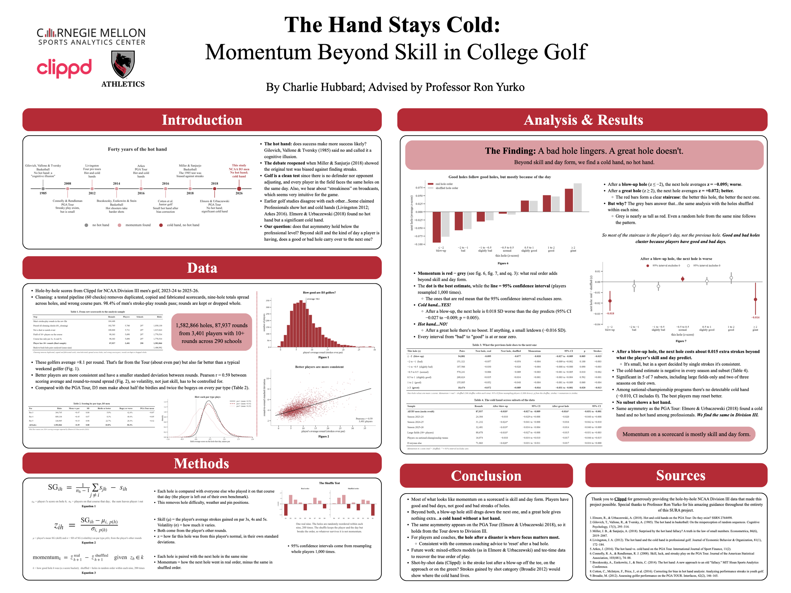

# The Hand Stays Cold: momentum beyond skill in college golf

Charlie Hubbard · advised by Professor Ron Yurko · Carnegie Mellon Sports Analytics Center (SURA) · data from [Clippd](https://www.clippd.com)

[](poster/The_Hand_Stays_Cold.pdf)

**[Poster (PDF)](poster/The_Hand_Stays_Cold.pdf)** · [poster text](poster/poster_text.md) · [analysis notebook](cold_hand_poster.ipynb)

## The finding

A bad hole lingers; a great hole doesn't. In 1.58 million holes of NCAA Division III men's golf, the hole after a blow-up is worse than the player's skill and the kind of day they're having would predict. The hole after a great hole gets no boost. This is a cold hand without a hot hand, the same pattern Elmore & Urbaczewski (2018) found on the PGA Tour.

- **Most apparent momentum is day form.** After a blow-up hole (z ≤ −2), the next hole averages z = −0.095; after a great hole (z ≥ 2), it averages +0.072. Shuffling the holes within each nine gives almost the same numbers. Good and bad holes cluster mostly because players have good and bad days.
- **The cold hand is what's left over.** After a blow-up, the next hole is 0.018 SD worse than the shuffled baseline (95% CI −0.027 to −0.009, p = 0.005). That is about 0.015 extra strokes: small, but consistent.
- **No hot hand.** After a great hole, the next hole is if anything slightly worse (−0.016 SD).
- **Robustness:**
  - the cold-hand estimate is negative in every season and every subset;
  - it is significant in 5 of 7 subsets;
  - it is not detectable among national-championship programs (−0.010, CI includes 0), which suggests the best players reset better.

## Data

Hole-by-hole scores for NCAA Division III men's golf from Clippd, 2023-24 through 2025-26.

The final sample is 1,582,866 holes and 87,937 rounds, from 3,401 players with at least 10 rounds, across 290 schools. A tested cleaning pipeline of 60 checks removes duplicated, copied and fabricated scorecards, nine-hole totals spread across holes, and wrong course pars. Rounds are kept or dropped whole, and 98.4% of men's stroke-play rounds pass.

**The data itself is not in this repository.** It was shared by Clippd for this project. Notebook outputs that showed individual rows have been cleared, so only aggregates remain.

## Method

1. **Strokes gained on each hole.** Each score is compared with the average of everyone else who played that hole on that course that day, leaving the player out. This removes hole difficulty, weather and pin positions.
2. **Z-score against the player.** Each hole's strokes gained is standardized by that player's own mean and spread on that par type, estimated from their other rounds. A z of −2 means a bad hole *for that player*.
3. **Shuffle test.** For each hole, the next hole's z is compared between the real order and 200 random orderings of the same nine. Shuffling keeps the player and the day but breaks the order. Momentum is the real result minus the shuffled one.
4. **Uncertainty.** 95% intervals come from resampling whole players 1,000 times.

## Repository

| Path | What it is |
|---|---|
| [`cold_hand_poster.ipynb`](cold_hand_poster.ipynb) | **The poster analysis.** Sample, z-scores, shuffle test, bootstrap intervals, and every figure and table on the poster |
| [`notebooks/01_cleaning.ipynb`](notebooks/01_cleaning.ipynb) | Raw file to clean hole and round tables; stops on the first failed check |
| [`notebooks/02_momentum_analysis.ipynb`](notebooks/02_momentum_analysis.ipynb) | Replication of Elmore & Urbaczewski's mixed-effects models in R. The data construction and descriptive tables are done; the full model fits are still to come |
| [`notebooks/03_strokes_gained_poster.ipynb`](notebooks/03_strokes_gained_poster.ipynb), [`poster_analysis.ipynb`](poster_analysis.ipynb) | Earlier versions of the poster analysis, which compared several ways of measuring momentum |
| [`R/`](R/) | Model, simulation and sensitivity-grid code for the mixed-effects replication |
| [`poster/`](poster/) | The poster (PDF and PNG), its text, and every figure at 300 dpi |
| [`archive/`](archive/) | Earlier notebooks, kept for reference |

## Running it

The notebooks expect Clippd's raw file at `data/raw/d3_data.csv`, which isn't included.

```bash
conda env create -f environment.yml && conda activate ds
jupyter nbconvert --to notebook --execute --inplace notebooks/01_cleaning.ipynb
jupyter nbconvert --to notebook --execute --inplace cold_hand_poster.ipynb
```

The R models in notebook 02 need R 4.5+ with `lme4`, `arrow` and `broom.mixed`.

## Next steps

- Fit the mixed-effects models (notebook 02), as Elmore & Urbaczewski do.
- Use tee-time data to recover the true order of play. There's no starting-hole column, so holes are only paired within the same nine, which is consecutive whether a round started on the 1st or 10th tee.
- Use shot-level strokes gained to find where the cold hand lives: off the tee, on the approach, or on the green.

## Thanks

Clippd, for providing the hole-by-hole data, and Professor Ron Yurko, for advising the project.
